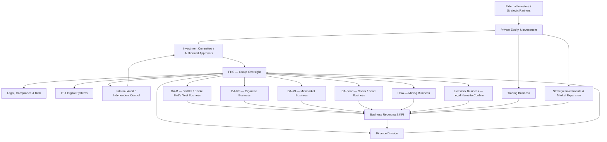
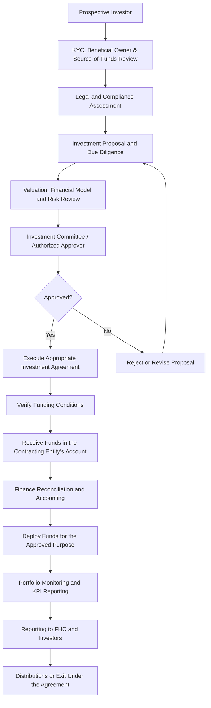

<p align="center">

</p>

<p align="center">

<div align="center">

<h3>
Cyber Defense Architect • Security Engineer • Web3 Builder
</h3>

<p align="center">
  <strong>FHC Group Oversight • Private Equity Framework • Finance Operations • Strategic Expansion</strong>
</p>

<p align="center">
  
  
  
  
</p>

<p align="center">
  
  
  
  
</p>

</div>

# FHC Group Oversight & Private Equity Framework

**Repository description:** A governance and operating framework for FAM Holding Company (FHC), covering group oversight, external-investor private equity workflows, finance administration, business-unit reporting, trading controls, IT enablement, market expansion, and a 90-day implementation roadmap.

> **Status:** Proposed operating framework. This repository documents a target-state design; it does not assert that any proposed department, investment vehicle, committee, licence, legal entity, funding commitment, or transaction is already established or approved.

---

## Table of Contents

- [Overview](#overview)
- [Design Principles](#design-principles)
- [Target Operating Model](#target-operating-model)
- [Organization and Oversight Structure](#organization-and-oversight-structure)
- [External Investor and Investment Workflow](#external-investor-and-investment-workflow)
- [Finance Division](#finance-division)
- [Business and Investment Portfolio](#business-and-investment-portfolio)
- [Trading Business Controls](#trading-business-controls)
- [IT and Digital Systems](#it-and-digital-systems)
- [Market Expansion](#market-expansion)
- [Recommended Repository Structure](#recommended-repository-structure)
- [90-Day Implementation Roadmap](#90-day-implementation-roadmap)
- [Management Dashboard and KPIs](#management-dashboard-and-kpis)
- [Security and Document Controls](#security-and-document-controls)
- [Regulatory and Legal Considerations](#regulatory-and-legal-considerations)
- [Disclaimer](#disclaimer)

---

## Overview

The FHC framework is designed to help coordinate and oversee a diversified group of operating businesses and strategic investments. It separates four responsibilities while connecting them through documented approvals and consistent reporting:

1. **FHC Group Oversight** — strategy, governance, delegated authority, group-level risk oversight, and performance review.
2. **Private Equity & Investment** — investor due diligence, investment analysis, valuation, investment proposals, portfolio monitoring, and exit planning.
3. **Finance Division** — treasury, accounting, budgeting, bank reconciliation, statutory reporting, and group consolidation.
4. **Trading and Operating Businesses** — execution under approved mandates, business-specific controls, and measurable performance targets.

**IT & Digital Systems** provides shared infrastructure for reporting, access management, data protection, and audit trails. Legal, Compliance & Risk supports all functions, while Internal Audit or an appropriately independent control function reviews whether policies are followed.

## Design Principles

- **One oversight framework:** group-wide policies, reporting standards, and escalation paths.
- **Clear accountability:** every approval, payment, journal entry, and review has an assigned owner.
- **Segregation of duties:** investment approval, payment execution, accounting, and independent review should not be controlled by a single person wherever practical.
- **Evidence-based reporting:** decisions rely on reconciled records and verifiable source documents.
- **Entity-level separation:** funds, contracts, liabilities, and books remain attributable to the correct legal entity.
- **Risk-adjusted investment decisions:** proposals are evaluated for commercial merit, liquidity, legal structure, downside risk, and exit feasibility.
- **Security by design:** sensitive investor and financial information is access-controlled, backed up, and auditable.
- **Regulatory first:** no investor solicitation or regulated investment-management activity should begin until the applicable legal and licensing position is confirmed.

## Target Operating Model



*This is a proposed functional model. Actual reporting lines, ownership relationships, and approval rights must follow the group's legal documents and formally adopted governance policies.*

## Organization and Oversight Structure

### 1. FHC — Group Oversight

**Core responsibilities**
- Establish group strategy, policies, and reporting requirements.
- Approve budgets, capital allocation, and material commitments within delegated authority.
- Review business performance, liquidity, and significant risks.
- Escalate unresolved issues and track management decisions.
- Receive consolidated reports without replacing each entity's own legal and management responsibilities.

### 2. Private Equity & Investment

**Core responsibilities**
- Maintain an investor and opportunity pipeline.
- Coordinate investor KYC, beneficial-owner checks, and source-of-funds review with qualified compliance personnel.
- Prepare investment memoranda, financial models, valuation analysis, and risk assessments.
- Present proposals to the designated investment committee or authorized decision-maker.
- Monitor approved investments, portfolio performance, covenants, distributions, and exit options.
- Provide investor reporting consistent with agreements and applicable law.

Private Equity must not independently approve its own proposal, execute payment, record the transaction, and certify the control review. These duties should be appropriately separated.

### 3. Finance Division

**Core responsibilities**
- Maintain the chart of accounts, ledgers, and supporting financial records.
- Manage budgets, cash-flow forecasts, payables, receivables, and bank reconciliations.
- Verify payment documentation and approved spending authority.
- Record intercompany transactions and reconcile balances.
- Prepare entity-level financial statements and group consolidation where applicable.
- Produce management and investor reports based on verified records.

### 4. Legal, Compliance & Risk

- Review corporate authority, investment agreements, and transaction documentation.
- Determine relevant licensing, investor-eligibility, offering, and reporting requirements.
- Coordinate KYC/AML controls and source-of-funds checks where required.
- Maintain a legal obligations register and risk register.
- Review cross-border investment, tax, data protection, and trading arrangements with qualified advisers.

### 5. IT & Digital Systems

- Support approved finance and investment systems, dashboards, and document repositories.
- Apply role-based access and multi-factor authentication where available.
- Maintain secure backups, recovery procedures, and audit logs.
- Avoid storing passwords, private keys, bank credentials, or unredacted identity documents in a public repository.

### 6. Trading Business

Trading operates as a distinct business function with its own mandate, counterparties, limits, settlement controls, profit-and-loss reporting, and compliance checks. It must not be treated as interchangeable with the group's investor-capital account.

---

## External Investor and Investment Workflow



### Required controls

| Control | Expected evidence |
|---|---|
| Investor onboarding | KYC record, beneficial-owner review, and source-of-funds evidence as applicable |
| Investment decision | Due-diligence report, financial model, risk assessment, and documented approval |
| Contracting | Executed agreement and verified signing authority |
| Funding | Bank evidence and confirmation that contractual conditions have been met |
| Deployment | Approved budget, payment authorization, invoices, and transaction records |
| Monitoring | Actual-versus-budget reporting, portfolio KPIs, risk updates, and valuation support |
| Distribution or exit | Contractual basis, approval, calculations, and accounting evidence |

Investor commitments, cash actually received, and cash deployed must be reported as **separate figures**. A framework agreement or headline contract value is not, by itself, proof that funds have been received or that investment capital is available.

## Finance Division

The Finance Division should use a consistent reporting template for every business unit. Local records remain attributable to the legal entity that generated the transaction; group consolidation must follow the applicable accounting framework.

### Finance workstreams

- Budgeting and forecasting
- Treasury and cash-flow management
- Bank statements and reconciliation
- Accounts payable and receivable
- General ledger and journal controls
- Tax and statutory reporting
- Fixed-asset register
- Intercompany transactions and reconciliation
- Financial statements and consolidation
- Investor reporting
- Internal controls and audit follow-up

### Recommended month-end close

1. Collect transaction records and supporting documents from each unit.
2. Reconcile bank accounts, cash, payables, receivables, and intercompany balances.
3. Review accruals, journals, fixed assets, and tax-related balances.
4. Compare actual results with budget and explain material variances.
5. Prepare entity-level reports and consolidation adjustments where applicable.
6. Review the management pack and document open issues, owners, and deadlines.
7. Distribute approved reports according to access rights and contractual obligations.

## Business and Investment Portfolio

The following labels are working identifiers from the proposed operating model. Confirm each unit's registered name, ownership, jurisdiction, and reporting entity before using the structure for statutory or contractual purposes.

| Working identifier | Business area | Example reporting focus |
|---|---|---|
| DA-B | Swiftlet / edible bird's nest business | Production, quality, inventory, sales, margin, and cash collection |
| DA-RS | Cigarette business | Procurement, production or distribution, inventory, compliance, sales, and margin |
| DA-MI | Minimarket business | Store-level sales, inventory turnover, shrinkage, gross margin, and cash reconciliation |
| DA-Food | Snack / food business | Production or sourcing, unit economics, stock expiry, distribution, and sales |
| HGA | Mining business | Legal permits, production, operating costs, safety, environmental obligations, and cash flow |
| Livestock unit | Livestock business; legal name to confirm | Herd or stock records, feed costs, mortality, sales, and working capital |
| Trading | Separate trading business | Approved mandate, counterparty exposure, settlement, realized/unrealized P&L, and limits |

No unit should be treated as a subsidiary solely because it appears in this table or in an organizational diagram.

## Trading Business Controls

Trading should have a documented mandate and an explicit approval framework.

- Define permitted instruments, products, markets, and counterparties.
- Establish transaction, exposure, concentration, and loss limits.
- Document who may initiate, approve, settle, and reconcile a trade.
- Perform counterparty due diligence and required sanctions checks.
- Reconcile contracts, delivery evidence, invoices, bank movements, and settlements.
- Record realized and unrealized profit or loss separately where applicable.
- Escalate limit breaches, failed settlements, suspicious activity, and disputed transactions.
- Report trading cash and positions separately from uncommitted investment capital.

## IT and Digital Systems

A practical implementation can begin with controlled spreadsheets and a secure document repository, then evolve into an ERP and management dashboard when processes and data definitions are stable.

Recommended capabilities:
- Role-based access control and least-privilege permissions
- Multi-factor authentication
- Approval workflows and change history
- Secure storage and encrypted backups
- Recovery testing and incident response
- Standardized reporting templates and data definitions
- Reconciliation between source systems and management reports

Do not commit real investor data, identity documents, bank statements, API keys, passwords, private keys, or other secrets to Git.

## Market Expansion

Indonesia, Europe, and Asia are proposed as market and investment geographies—not automatically as subsidiaries or legal entities.

### Indonesia
- Evaluate expansion of existing operating businesses.
- Assess strategic partners, suppliers, distribution, and financing needs.
- If “BEJ” refers to the Indonesian capital market, confirm whether the intended reference is the Indonesia Stock Exchange (BEI) or a specific entity or market opportunity.

### Europe
- Screen commercial fit, local counterparties, tax exposure, legal structure, and regulatory obligations.
- Obtain jurisdiction-specific advice before committing capital or marketing investments.

### Asia
- Evaluate regional partners, supply chains, trading opportunities, and market-entry costs.
- Check country-specific licensing, foreign-investment, tax, and compliance requirements.

Every opportunity should pass the same investment-screening process: source of capital, ownership structure, expected cash flow, downside risk, legal feasibility, funding conditions, and exit strategy.

## Recommended Repository Structure

```text
FHC-Group-Oversight-Private-Equity/
├── README.md
├── LICENSE
├── docs/
│   ├── governance/
│   ├── organization/
│   ├── investment-policy/
│   ├── finance-operations/
│   ├── trading-controls/
│   ├── it-security/
│   └── implementation-roadmap/
├── templates/
│   ├── investment-memorandum/
│   ├── due-diligence/
│   ├── budget-and-forecast/
│   ├── monthly-finance-report/
│   ├── bank-reconciliation/
│   ├── risk-register/
│   └── management-dashboard/
├── diagrams/
│   ├── organization.mmd
│   ├── investment-workflow.mmd
│   └── finance-reporting.mmd
├── scripts/
│   └── create-folders.sh
├── .gitignore
└── SECURITY.md
```

This is a documentation and governance repository. Confidential operating records should be kept in an appropriately secured business system, not in a public GitHub repository.

## 90-Day Implementation Roadmap

### Days 1–30 — Governance Foundation
- Approve the target organization and delegated-authority matrix.
- Verify legal names, entity ownership, directors, and jurisdictions.
- Inventory bank accounts, contracts, assets, liabilities, and capital commitments.
- Define reporting templates and folder permissions.
- Assign accountable owners to each workstream.

**Exit criteria:** approved governance baseline, entity register, responsibility matrix, and documented reporting requirements.

### Days 31–60 — Finance and Investment Controls
- Start monthly unit-level financial reporting.
- Implement bank reconciliation and payment controls.
- Create the investor register and investment-opportunity pipeline.
- Prepare investment-memorandum and valuation templates.
- Review legal and licensing requirements for the intended external-investor model.
- Document trading mandates and risk limits.

**Exit criteria:** usable finance reports, documented controls, and standardized investment-review documents.

### Days 61–90 — Integration and Expansion
- Build an FHC management dashboard.
- Integrate finance and business-unit reporting.
- Screen Indonesia, Europe, and Asia opportunities using consistent criteria.
- Test the investment approval, funding, deployment, and reporting process.
- Review ERP requirements, cybersecurity, backup, and audit needs.
- Hold a formal group performance review and track corrective actions.

**Exit criteria:** repeatable reporting process, tested controls, documented investment pipeline, and an owned action plan for remaining gaps.

## Management Dashboard and KPIs

| Dashboard | Core indicators | Suggested cadence |
|---|---|---|
| Finance | Cash position, cash flow, receivables, payables, budget variance | Weekly / monthly |
| Business units | Revenue, gross margin, operating costs, inventory, operating targets | Monthly |
| Private Equity | Commitments, capital received, capital deployed, valuation, portfolio risk | Monthly / quarterly |
| Trading | Open exposure, settlement status, realized P&L, limit utilization | Daily / weekly |
| Legal & Compliance | Licence status, contract deadlines, onboarding status, open compliance findings | Monthly |
| IT | System availability, access reviews, backup status, security incidents | Monthly |
| Group Oversight | High risks, budget deviations, overdue decisions, corrective actions | Monthly |

Each KPI should have a named owner, definition, source, reporting date, and review status. Reports should distinguish actual results from forecasts, commitments, and estimates.

## Security and Document Controls

- Keep sensitive business data outside public repositories.
- Use least-privilege access and multi-factor authentication.
- Store secrets in an approved secret manager, never in source code.
- Maintain encrypted backups and test recovery procedures.
- Record approvals and material changes.
- Apply a retention policy to legal, financial, and investor documents.
- Use redacted or synthetic examples in public documentation.
- Do not describe a transaction as completed unless it is supported by verifiable evidence.

## Regulatory and Legal Considerations

The applicable requirements depend on the actual legal structure, activities, instruments, investor type, jurisdiction, and manner in which investments are offered or managed. Before external fundraising or investment-management activity begins:

1. Confirm the contracting and receiving legal entity.
2. Obtain advice on the relevant Indonesian corporate, securities, investment-management, and other sector-specific rules.
3. Confirm whether licensing, registration, investor eligibility, offering restrictions, or reporting obligations apply.
4. Review cross-border tax, foreign-investment, sanctions, AML/KYC, and data-protection obligations where relevant.
5. Obtain approval from the properly authorized decision-maker and document the decision.

This repository is an operating-design proposal, not a legal determination that FHC is authorized to conduct a regulated activity.

## Disclaimer

This framework is for planning, governance design, and internal process development. It is not an offer to sell securities, a solicitation of investment, a guarantee of returns, or legal, tax, accounting, or investment advice. All proposed structures and workflows must be validated against the actual corporate documents, facts, applicable laws, and professional advice before implementation.

---

<p align="center">
  <sub>Designed as a governance and operating blueprint for FHC — FAM Holding Company.</sub>
</p>
